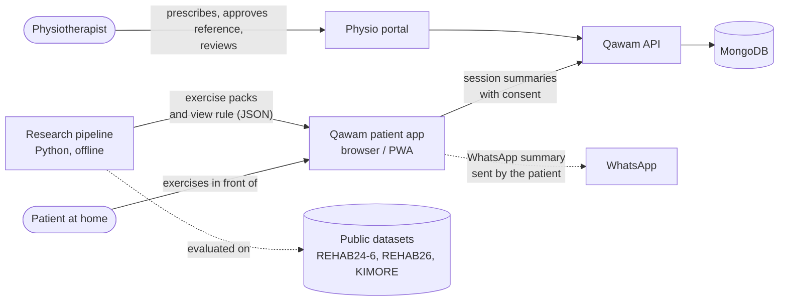
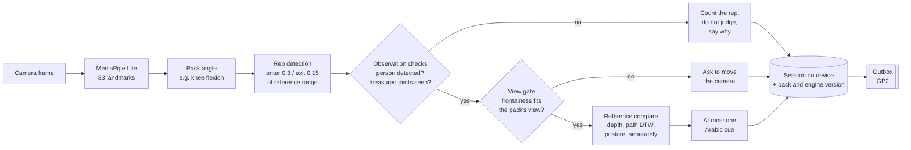
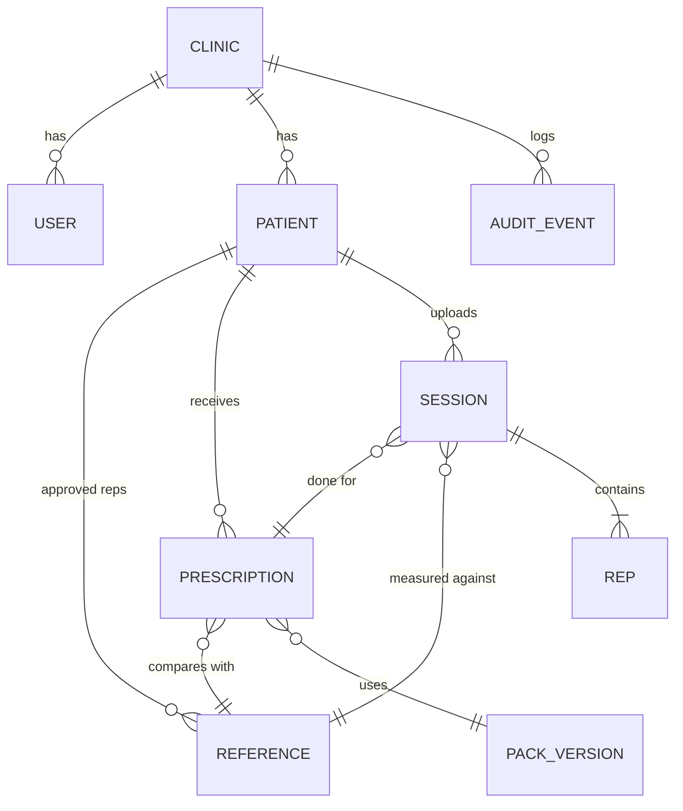
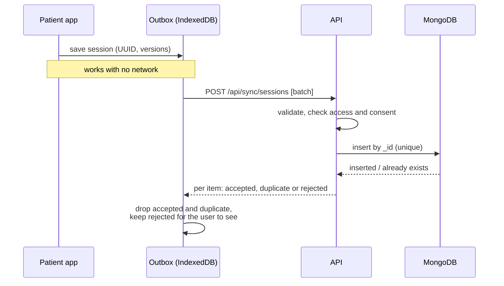

# Qawam system architecture

Status: GP1 prototype built (patient app, research pipeline, exercise packs); GP2 backend core started (`api/src`, pure TypeScript, tested); Express routes, MongoDB adapter and physio portal planned for GP2 (February to June 2027). Author: Eyad Amgad. Last updated 2026-11-02.

This document is the reference for how the parts fit together and why. Decisions behind it are in `docs/decisions.md`; measured results are in `docs/experiments.md`.

---

## 1. Principles

1. **Video never leaves the patient's device.** Pose estimation, measurement and feedback run in the browser. Only numbers about reps leave the device, and only with consent.
2. **Silence beats a wrong correction.** Each rep passes observation checks and a view gate before any movement cue. A rep that fails is counted but not judged, and the reason is recorded.
3. **The patient's own reference, approved by a physio.** Home reps are compared with a rep the physio approved in clinic, not with a universal threshold.
4. **Everything that produces a number is versioned.** The exercise pack, the coaching engine and the reference used are stored with every session, so old results stay interpretable.
5. **Offline first.** A session is saved on the device before anything is sent; upload is a retryable background step that can never create duplicates.

## 2. Context

| Actor or system | Role |
| --- | --- |
| Patient | Does the exercises at home; owns their consent. |
| Physiotherapist | Prescribes, records and approves the reference rep, reviews progress and flagged sessions. |
| Clinic admin | Manages the clinic's accounts and patient assignments; no clinical actions. |
| System admin | Runs the platform; no access to clinical data. |
| WhatsApp | Delivery channel for summaries the patient or physio chooses to send (a `wa.me` link today, no API integration). |
| Public datasets | Research only, never in the product database (licences: REHAB24-6 and REHAB26 non-commercial). |

## 3. Containers

| Container | Technology | Responsibility | Status |
| --- | --- | --- | --- |
| Patient app | React, TypeScript, Vite; MediaPipe Pose Landmarker Lite (WASM, offline copy) | Set-up check, live coaching, Arabic voice, local session store, report, WhatsApp/PDF/CSV | Built |
| Exercise packs | JSON + JSON Schema in `rules/packs/` | What the software knows about each exercise: angles, view, posture angle, cue wording, version | Built (5 packs) |
| Research pipeline | Python (NumPy, pandas) in `ml/` | Dataset loaders, angle and gate evaluation, view-rule export, KIMORE study | Built |
| API core | TypeScript in `api/src` (no framework) | Data model, validation, access policy, session sync, clinical use cases, audit | Built and tested (this change) |
| API server | Node.js 22 + Express | HTTP routes, authentication, mapping of `Denied` codes to statuses | GP2 |
| Database | MongoDB with JSON-schema validators | Clinics, users, patients, prescriptions, references, sessions, audit | GP2 |
| Physio portal | React (same toolchain as the patient app) | Patient list, prescribing, reference approval, history, review queue | GP2 |

The API is a **modular monolith**: one deployable, with the domain (`api/src/domain`), use cases (`api/src/app`) and storage adapters (`api/src/store`) kept apart. Use cases depend only on the `Store` interface, so the same tests run against the in-memory store now and against MongoDB in GP2.

## 4. Patient app: the per-rep pipeline

Modules (`web/src/exercise/`): `videoPose` (model loading, offline-first), `liveCoach` (frame loop, rep state, observation checks, judging), `viewGate`, `referenceCompare`, `repSegmentation`, `session` (file analysis), `sessionStore` (local history, CSV, WhatsApp text), `exercisePack`, and the screens `LiveCamera`, `ExerciseCoach`, `ProgressReport`.

Abstain reasons recorded per rep: `LOW_DETECTION` (person missing in most frames), `JOINTS_HIDDEN` (a joint of the measured angle hidden or cut off in most frames), `VIEW_MISMATCH` (wrong camera angle), `NOT_CERTIFIED` (the pack has `correctionCues: false` and only counts reps; set for shoulder abduction after the Fit3D test). The thresholds and how they were set are in `docs/experiments.md`.

## 5. Data boundary

| Data | Where it lives | Leaves the device? |
| --- | --- | --- |
| Camera frames | Memory only, frame by frame | Never; never stored |
| Landmarks | Memory only, during the session | Never; the API refuses any extra field, so landmarks cannot be uploaded by mistake |
| Reference curve (one approved rep, angle values only) | Device; server copy in GP2 | To the clinic, as the physio's record |
| Session summary (per-rep range, differences, cue or abstain reason, versions) | Device first | Only with the patient's `syncSessions` consent |
| WhatsApp summary | Built on the device | Only when the patient or physio presses send; carries name, exercise, counts and range, no diagnosis |
| Identity, clinic, prescriptions, consent | Server (GP2) | n/a |
| Research datasets and results | Research laptop, git-ignored | Only aggregate numbers are committed |

## 6. Domain model

The key separation: an **exercise pack** is what the software knows about an exercise; a **prescription** is what one physio asked one patient to do. A **reference** is the approved rep a prescription points at. A **session** stores which of each it was measured against.

Types are in `api/src/domain/model.ts`. Collections for MongoDB (all clinical ones carry `clinicId`):

| Collection | Key fields | Indexes (planned) | Notes |
| --- | --- | --- | --- |
| `clinics` | name, contact | | |
| `users` | role, clinicId, passwordHash | unique email | `patient` users link to one patient record |
| `patients` | clinicId, displayName, assignedPhysioIds, consent | `{clinicId, _id}` | consent changed only by the patient |
| `references` | clinicId, patientId, packId, packVersion, engineVersion, side, curve, approvedBy, status, replacedBy | `{clinicId, patientId, packId, status}` | never overwritten: a new approval retires the old one |
| `prescriptions` | clinicId, patientId, physioId, packId, packVersion, side, sets, reps, toleranceDeg, referenceId, status | `{clinicId, patientId, status}` | |
| `sessions` | client UUID as `_id`, clinicId, patientId, prescriptionId, referenceId, packVersion, engineVersion, reps[], contentHash, reviewFlags | unique `_id`; `{clinicId, patientId, startedAt}` | insert-only; never edited |
| `auditEvents` | at, actorId, clinicId, action, resource | `{clinicId, at}` | append-only; no update or delete route exists |

Exercise packs stay files in `rules/packs/` (versioned in git, validated by `pack.schema.json`); the server stores only `packId` and `packVersion` references to them.

## 7. API

Planned Express routes, each a thin wrapper over a use case in `api/src/app`. `Denied` codes map to statuses (`NOT_FOUND` 404, `FORBIDDEN` 403, `INVALID` 422, `CONFLICT` 409).

| Route | Use case | Who |
| --- | --- | --- |
| `POST /api/auth/login`, `POST /api/auth/refresh` | authentication (GP2) | everyone |
| `GET /api/patients/:id/sessions` | `patientSessions` | the patient, assigned physio, clinic admin |
| `GET /api/patients/:id/review` | `reviewQueue` | same |
| `POST /api/patients/:id/references` | `approveReference` | assigned physio |
| `POST /api/patients/:id/prescriptions` | `prescribe` | assigned physio |
| `PUT /api/patients/:id/consent` | `setConsent` | the patient |
| `POST /api/sync/sessions` | `ingestSessions` (batch of up to 50) | the patient |

A patient of another clinic is answered as **not found**, not forbidden, so the API never confirms that an id exists elsewhere.

## 8. Offline-first sync

- The session id is a UUID generated on the phone (`newSessionId`, already built). It is the idempotency key: a resend after a dropped connection returns `duplicate` and changes nothing.
- The same id with different content is `ID_CONFLICT`, never an overwrite.
- Each item is judged on its own; one bad item does not block the batch.
- A session done against an older pack version or a since-retired reference is **accepted and flagged** (`PACK_VERSION_DIFFERS`, `REFERENCE_RETIRED`) for the physio's review queue, because the patient did the work and the record says exactly what it was measured with. A session where no rep could be judged is flagged `NOTHING_ASSESSED`.
- Withdrawn consent stops uploads (`NO_CONSENT`); local data stays on the device under the patient's control.

Built now: the server side (`api/src/app/sync.ts`) and the device-side id. GP2: the IndexedDB outbox and the background sender in the patient app (localStorage stays for the prototype's local history).

## 9. Security and privacy

- **Authentication (GP2):** short-lived access token plus refresh token in an httpOnly cookie; passwords hashed with a slow hash.
- **Authorization:** `api/src/domain/access.ts`. Every rule checks the clinic first, then the role, then assignment. Physios see only assigned patients; clinic admins administer but do not prescribe; system admins see no clinical data; patients see only themselves.
- **Clinic scoping in storage:** every `Store` read of clinical data takes the clinic id, so an unscoped query does not type-check.
- **Audit:** every write and every read of a patient's sessions appends an event; the store has no update or delete for audit events.
- **Consent:** only the patient changes it; it gates uploads and WhatsApp sharing.
- **Input:** uploads are validated field by field and unknown fields are refused (this is also what keeps landmarks off the server).
- **Law:** Egypt's Personal Data Protection Law (Law 151 of 2020) and the MSA ethics approval govern the pilot; retention and deletion rules will be written with the ethics application. Not yet verified with a lawyer.

## 10. Versioning and reproducibility

| What | Version carried by | Where it is recorded |
| --- | --- | --- |
| Exercise pack (angles, view, cues) | `version` in each pack JSON | prescription and every session |
| Coaching logic (rep detection, checks, comparison) | `COACH_ENGINE_VERSION` in `sessionStore.ts` | every session and reference |
| Reference rep | reference id; retired, never overwritten | every session |
| View thresholds | `view_rule.json` from `ml/eval/gate_eval.py` | research log; to be re-derived from our own data before commercial use |
| Research results | script + data split + date | `docs/experiments.md` |

## 11. Performance

MediaPipe's web inference runs on the main thread. We measure first, then decide: on the target phones, record frames processed per second, latency from frame to cue, and dropped frames during a live session. If the interface stutters, pose inference moves to a Web Worker, which separates rendering, inference, measurement and speech. Targets will be set from that baseline, not guessed.

## 12. Testing levels

| Level | What it proves | Where |
| --- | --- | --- |
| Unit | angles, rep detection, observation checks, view gate, comparison, cue choice; access rules; validation; sync idempotency | `web/src/**/*.test.ts`, `api/src/*.test.ts`, `tests/python` |
| Integration | pose output flows through the pack to a stored session | component tests; GP2: API against a test MongoDB |
| End to end | camera, offline loading, a full session, report | Playwright with a fake camera and all outside network blocked |
| Performance | frame rate, latency, memory on real phones | GP2 benchmark (section 11) |
| Validation | measurement accuracy and cue correctness against people | goniometer study, physio cue review, pilot |

## 13. Built vs planned, and the GP2 build order

| Built and tested | GP2, in this order |
| --- | --- |
| Patient app: live coaching for 5 exercises, observation checks, view gate, reference compare, Arabic voice, local history, report | 1. Express server over the API core; MongoDB adapter passing the same tests; tenant-isolation tests over HTTP |
| Session provenance and device-generated ids | 2. Authentication and roles |
| API core: model, validation, access policy, idempotent sync, references, prescriptions, consent, audit, review flags | 3. IndexedDB outbox and background sync in the patient app |
| Research pipeline and three dataset studies | 4. Physio portal: patients, reference approval, prescribing, history, review queue |
| Offline demo | 5. Frame-rate benchmark; Web Worker only if needed |
| | 6. Pilot hardening: consent screens, retention, export and delete |

The exercise catalogue stays at five during the GP2 build; new exercises come only after the existing ones are validated.
